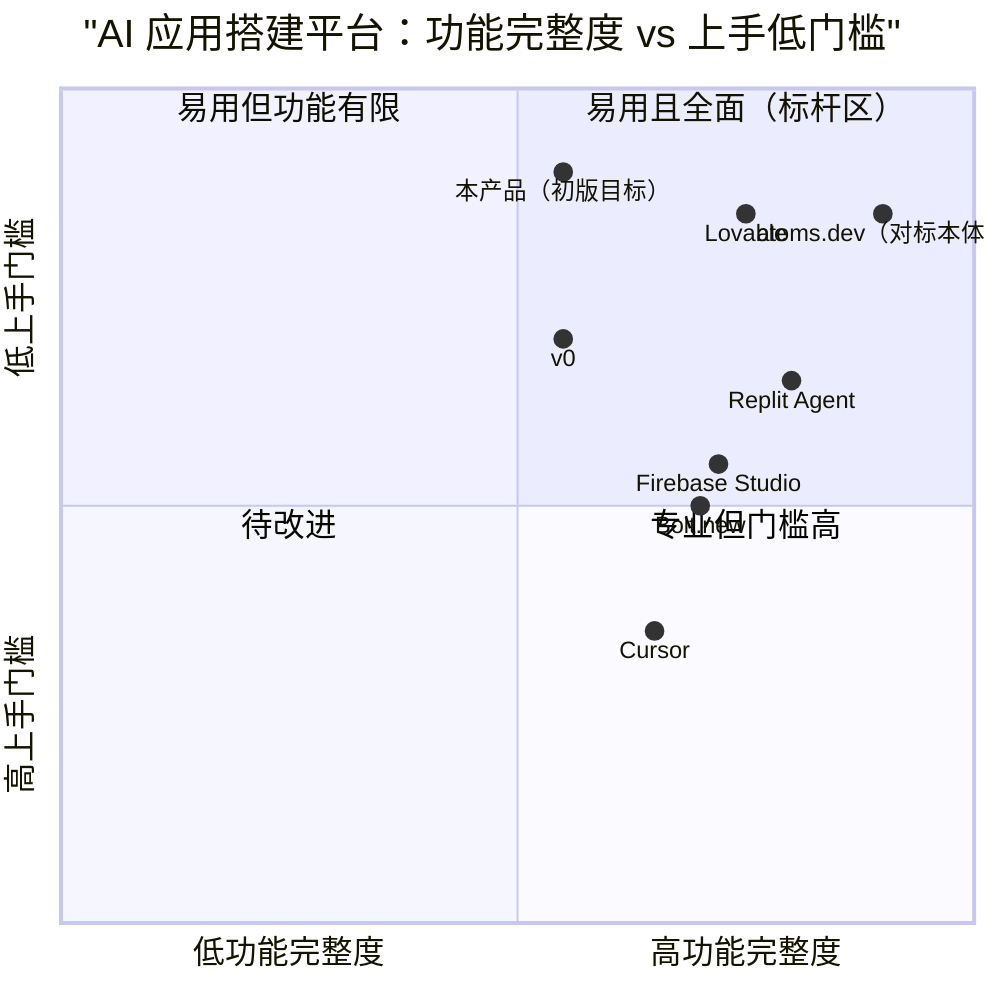

# 产品需求文档（PRD）：复刻 Atoms 平台（atoms.dev）

> 文档版本：v3.0（终稿）｜ 阶段：需求设计阶段（待用户检查） ｜ 日期：2026-09-02
> v3.0 修订说明：用户已答复全部遗留问题，本版为需求设计阶段终稿——①去除账号与登录模块（无登录态、打开即用）；②AI 文本生成模型池固定为 claude-opus-5、deepseek-v4-flash、gpt-5.6-sol（不提供池外模型自选），非文本 AI 能力沿用平台默认模型；③不做代码包导出，交付物为平台内发布的已部署系统 + 可直接访问域名（原「导出形态」条目改写为「发布与域名访问」纳入初版）；④模板来源为官方内置模板 + 复制现有项目（Remix）；⑤管理员后台不做；⑥界面仅保留中文。最终取舍清单：**纳入 11 项 / 暂缓 13 项 / 不做 10 项**，无遗留开放问题。

---

## 1. 项目信息

| 项目 | 内容 |
|------|------|
| 项目名称 | atoms_platform_clone |
| 复刻目标 | atoms.dev 平台（一比一还原平台能力），工作台入口 https://atoms.dev/zh/dashboard |
| 工作语言 | 中文（界面与文案仅中文，用户确认） |
| 产品形态 | Web 应用（前后端分离），**无需注册登录，打开即用** |
| 前端技术栈 | React 18 + TypeScript + Vite + shadcn/ui + Tailwind CSS（`app/frontend`） |
| 后端服务 | Atoms Cloud（Database / File Storage / Edge Functions / AI Capabilities，已激活；平台自身不启用面向终端用户的登录） |
| AI 模型约束 | 文本生成模型池固定为 **claude-opus-5（默认）、deepseek-v4-flash、gpt-5.6-sol**（用户指定）；图像/视频/音频等非文本 AI 能力沿用平台默认模型 |
| 交付形态 | 应用在平台内发布为**已部署系统 + 可直接访问的域名**，不做代码包导出 |
| 设计系统 | **Notion** 主题（最小化柔和灰阶，语义化 CSS 变量，全站强制使用） |

### 原始需求重述

用户要求复刻 atoms.dev 平台、一比一还原平台能力；初版可实现核心能力的复刻，功能取舍须停下来询问用户并由用户确认；整体按六阶段推进（需求设计、UI 设计、技术方案设计、开发、测试、发布部署），每阶段产出由用户检查通过后进入下一阶段。项目已完成初始化。用户已依次确认全部取舍决定（详见 8.4 决策记录），本 PRD 为冻结待检的终稿。

### 调研依据说明

- 已实测访问 atoms.dev 中文官网与 dashboard 入口、官方帮助中心 Quick Start 与平台能力总览文档；
- dashboard 页面需登录后访问（未登录抓取返回落地页），登录后的工作台结构依据官方文档佐证（如「你可以在仪表板上实时查看积分余额和使用情况」等官方 FAQ 表述）。

---

## 2. 产品定位与目标

### 2.1 产品定位

对标 atoms.dev 的对话式 AI 应用开发平台：用户通过自然语言对话描述想法，由平台内置的多 Agent 团队（团队负责人、产品经理、架构师、工程师、数据分析师等）协作完成 Web 应用的规划、构建、测试、预览与发布，交付物为已部署、可通过域名直接访问的真实应用。产品口号心智对齐 atoms.dev——「把想法变成可销售的产品，几分钟内完成，无需编码」。**初版无需注册登录，打开工作台即可直接开始构建；应用在平台内完成发布，获得可直接访问的域名。**

### 2.2 产品目标（三个正交目标）

| # | 目标 | 衡量标准 |
|---|------|----------|
| G1 | **核心链路完整还原**：完整实现「工作台 → 对话驱动开发 → 编辑/预览 → 发布获得域名 → 分享」主链路，覆盖第 10 章取舍清单中全部「纳入」项 | 纳入项 100% 实现，主链路端到端可跑通，发布后域名可直接访问 |
| G2 | **零门槛使用**：无需注册登录，打开即用，任何人可独立完成从进站到发布应用的全流程 | 新用户 5 分钟内完成「进站 → 创建项目 → 对话生成 → 发布获得域名」全流程 |
| G3 | **体验一致**：全站遵循 **Notion** 主题；界面布局与交互习惯对标 atoms.dev（工作台 + 对话区 + 右侧工具面板 + 顶部发布/分享） | 无硬编码视觉值；界面结构与交互还原度经用户检查确认 |

---

## 3. 用户角色与用户故事

### 3.1 用户角色

| 角色 | 描述 |
|------|------|
| 用户（主角色） | 无需注册登录、直接使用平台的访问者，通过对话创建和管理应用项目 |
| 访客（次角色） | 通过分享/发布链接查看已部署应用或分享内容的访问者（与主角色在无登录态下行为一致） |

> 说明：初版无账号体系，主角色与访客能力一致；二者的区分仅为「是否持有项目分享/发布链接」。

### 3.2 用户故事

1. 作为用户，我想打开平台即直接进入工作台（无需注册登录），以便最快开始把想法变成产品。
2. 作为用户，我想从官方内置模板或复制现有项目快速起步，也可以从零通过对话创建应用，以便按习惯选择起点。
3. 作为用户，我想上传图片/文件作为素材，以便让 Agent 按我的素材构建界面与内容。
4. 作为用户，我想在代码编辑器中查看并修改生成的代码，同时实时预览 PC/移动双端效果，以便精细控制交付质量。
5. 作为用户，我想一键把应用发布为可直接访问的域名链接并分享给他人，以便交付已部署的成果并向客户分发。
6. 作为用户，我想在工作台查看项目列表与状态，以便掌控开发进度。

### 3.3 无登录态设计的影响说明（重要）

去除账号与登录模块后，以下设计随之调整，并将在后续 UI/技术方案阶段落实：

| 影响点 | 无登录态下的处理方式 |
|--------|----------------------|
| 项目归属 | 项目不与用户绑定；初版项目数据存储于浏览器本地（localStorage），不做用户隔离 |
| 数据隔离与鉴权 | 不存在用户鉴权；后端接口按匿名/项目维度访问，不涉及个人数据 |
| 分享权限分级 | 原 Public / Secret / Private 三级依赖账户归属，初版简化为「生成公开链接，任何持链接者可访问」；Private 隔离能力随账户体系回归再评估 |
| 积分/配额体系 | 积分余额、消耗明细与账户绑定，初版一并暂缓（无归属主体），随账户体系回归统一规划 |
| 发布记录 | 发布信息（项目 ID、发布域名、时间）存于云端数据库，按项目而非用户维度管理；发布物为已部署系统，持域名即可访问 |

---

## 4. Atoms 平台能力全景清单（基于 atoms.dev 实测调研）

> 下表为 atoms.dev 实际具备的能力盘点，作为复刻范围的对标基线。证据来源：中文官网首页能力区与 FAQ、官方帮助中心。标注「※」的项为本复刻已按用户决定调整范围的项。

| 能力域 | 能力项 | 能力说明（实测） |
|--------|--------|------------------|
| 对话式开发 | 对话驱动构建 | 自然语言对话生成可运行的 Web 应用，「几分钟内完成，无需编码」 |
| 对话式开发 | 提示词润色（Polish Prompt） | 发送前可先润色 prompt 以节省积分 |
| 对话式开发 | 多 Agent 团队 | 8 个智能体协作：Mike（团队负责人）、Emma（产品经理）、Bob（架构师）、Alex（工程师）、David（数据分析师）、Iris（深度研究员）、Sarah（SEO 专家）、Adrian（广告专家） |
| 对话式开发 | 模式切换 | Team Mode（多 Agent 协作）/ Engineer Mode（仅工程师）/ Race Mode / Deep Research Mode |
| 对话式开发 | 竞赛模式（Race Mode） | 同一 prompt 在多个模型上并行运行，即刻获得最佳版本 |
| 对话式开发 | 模型选择 | 多种 LLM 可选：Claude Sonnet（默认）、GPT、Gemini、DeepSeek、Qwen（※本复刻文本模型池固定为 claude-opus-5、deepseek-v4-flash、gpt-5.6-sol，用户指定，不提供池外模型自选） |
| 对话式开发 | 文件/图片上传 | 输入框「+Add」上传文件或文件夹；图片可上传或直接粘贴 |
| 对话式开发 | 参考素材（Add References） | 上传参考图/灵感图供 Agent 构建时参照 |
| 编辑与预览 | Editor 代码编辑器 | 查看全部生成文件、选中编辑；面向高级用户 |
| 编辑与预览 | 可视化编辑器（Visual Editor） | 「精准实现你的设计」，可视化快速调整布局和组件 |
| 编辑与预览 | Terminal | 查看 Agent 在终端中的执行过程 |
| 编辑与预览 | App Viewer 预览 | 发布前预览构建结果，支持移动/PC 双视图 |
| 编辑与预览 | 视觉元素修改 | 在 App Viewer 中选中元素手动调整或与 Agent 讨论修改；添加/交换图片 |
| 编辑与预览 | Bug Fix | 点击 Fix Bug 由 Agent 修复构建问题 |
| 版本管理 | Remix 分叉 | 从当前版本分叉新分支，保留开发上下文，以版本摘要追踪变更 |
| 版本管理 | Versions 切换 | 右上角 Versions 按钮查看并切换历史版本 |
| 后端与集成 | Atoms Cloud | 自建全栈后端：用户登录（Auth）、数据库、集成、可扩展托管 |
| 后端与集成 | Supabase 连接器 | Settings → Connectors 连接 Supabase，实现数据存储、密钥管理、后端扩展 |
| 后端与集成 | 即时 AI 集成 | 使用 Gemini/GPT 等模型为应用添加 AI 能力，无需 API 密钥、无需设置（※本复刻文本能力限定指定模型池，非文本能力沿用平台默认模型） |
| 后端与集成 | Stripe 支付 | 内置支付能力，发布后即可收费（※用户决定不做，涉及真实资金流） |
| 后端与集成 | 第三方工具集成 | 支持与常用工具集成接入现有工作流 |
| 发布与增长 | 一键发布 | 一键发布生成在线 URL，托管与服务器配置由平台处理（※本复刻交付物定义为已部署系统 + 可直接访问域名，已纳入初版） |
| 发布与增长 | Share 分享 | 导出代码；对话权限 Public/Secret/Private；复制链接；分享至社交平台（※本复刻不做代码导出，分享简化为公开链接） |
| 发布与增长 | 代码导出 / GitHub 同步 | 随时导出代码或同步到 GitHub（※用户明确决定不做代码包导出，交付物为已部署系统 + 域名） |
| 发布与增长 | SEO 智能体 | 自动生成 SEO 页面并优化，让 Google 爬取、索引、排名 |
| 发布与增长 | 广告专家（Ads） | 自动运行 Google Ads：广告系列创建、跟踪、优化 |
| 发布与增长 | 收入集中展示 | 构建收入仪表板，集中展示变现数据 |
| 工作台与账户 | Dashboard 工作台 | 项目管理入口；实时展示积分余额与使用情况（※本复刻免登录直达，余额展示随账户暂缓） |
| 工作台与账户 | 账户与设置 | 账户管理与偏好配置（※初版去除，经用户决定） |
| 工作台与账户 | 订阅与 Credit 体系 | 订阅计划（Free/Pro/Max）；积分按任务复杂度消耗（※依赖账户，初版暂缓） |
| 工作台与账户 | Cloud & AI Wallet | 钱包余额与订阅积分相互独立（※依赖账户，初版暂缓） |
| 获客起点 | 模板库（Templates） | 官方模板（SaaS 落地页、电商、作品集等）作为起点（※本复刻模板来源确认为官方内置模板 + 复制现有项目 Remix，已纳入初版） |
| 获客起点 | App World 社区 | 社区作品广场，可 Remix 他人项目起步（※不做，社区运营型能力；「复制现有项目」以平台内已有项目/内置示例为对象） |
| 获客起点 | 新手引导 | 快速开始指南与视频教程 |
| 其他 | 多语言支持 | 支持多语言自然语言输入与界面（※本复刻仅保留中文，经用户确认） |
| 其他 | 深度研究 | Deep Research 发现真实需求与细分市场，输出聚焦的机会分析 |

---

## 5. 功能需求（按模块拆分）

> 优先级约定：**Must**＝初版必须有（P0）；**Should**＝初版应尽量有（P1）；**May**＝初版可延后（P2）。与第 10 章取舍清单一一对应。初版不含账户模块（用户决定去除），无遗留开放问题。

### M1 工作台（Dashboard）与项目管理
| 编号 | 功能点 | 优先级 | 说明 |
|------|--------|--------|------|
| M1-1 | 项目列表 | Must | 展示全部项目（名称、时间、状态），支持搜索；数据本地存储 |
| M1-2 | 创建 / 删除项目 | Must | 创建项目提供三种起点：**空白对话 / 官方内置模板 / 复制现有项目（Remix 起步）**（模板来源经用户确认）；删除需二次确认 |
| M1-3 | 项目状态标识 | Should | 标识「开发中 / 已发布」 |
| M1-4 | 积分余额与用量展示 | May | 对标 atoms.dev 仪表板余额展示；因去除账户暂缓，随账户体系回归（见取舍 B4） |

### M2 对话式开发（核心）
| 编号 | 功能点 | 优先级 | 说明 |
|------|--------|--------|------|
| M2-1 | 对话消息流 | Must | 用户与 Agent 消息流，支持 Markdown 与代码块渲染 |
| M2-2 | 对话驱动应用生成 | Must | 输入需求后经 AI 能力生成/迭代应用代码，同步至编辑器与预览；**文本生成模型池固定为 claude-opus-5（默认）、deepseek-v4-flash、gpt-5.6-sol**（用户指定，不提供池外模型自选），初版对话固定使用默认模型 |
| M2-3 | 流式响应与执行过程展示 | Must | 回复流式输出；展示 Agent 执行步骤日志 |
| M2-4 | 文件/图片上传 | Must | 输入框上传图片（支持粘贴）；文件上传初版支持单文件 |
| M2-5 | 参考素材上传 | Should | 对标 Add References，上传参考图供生成参照 |
| M2-6 | 每轮消耗明细 | May | 对标「…」菜单查看消耗；依赖计费体系，随账户暂缓 |
| M2-7 | 模型切换 | May | 仅可在已确认的三模型池内切换（claude-opus-5 / deepseek-v4-flash / gpt-5.6-sol）；初版固定默认模型，不提供池外自选 |
| M2-8 | 模式切换（Team/Engineer） | May | 初版仅保留 Team Mode 行为 |
| M2-9 | 提示词润色 | May | 发送前润色 prompt |
| M2-10 | 竞赛模式（Race Mode） | May | 同一 prompt 多模型并行取最佳，初版暂缓 |
| M2-11 | Deep Research Mode | May | 深度调研并输出市场机会报告，初版暂缓 |

### M3 编辑器与终端（Editor / Terminal）
| 编号 | 功能点 | 优先级 | 说明 |
|------|--------|--------|------|
| M3-1 | 文件树浏览 | Must | Editor 面板展示项目全部文件，目录结构可视化 |
| M3-2 | 代码查看与编辑 | Must | 选中文件查看并支持手动编辑保存 |
| M3-3 | 代码高亮 | Must | 主流语言语法高亮 |
| M3-4 | Terminal 执行日志 | Must | Terminal 面板查看 Agent 执行过程 |
| M3-5 | 可视化编辑器 | May | 可视化调整布局与组件，实现成本高，初版暂缓 |

### M4 预览与发布（App Viewer）
| 编号 | 功能点 | 优先级 | 说明 |
|------|--------|--------|------|
| M4-1 | 实时预览（移动/PC 双视图） | Must | App Viewer 实时渲染构建结果，支持双视图切换 |
| M4-2 | 一键发布与域名访问 | Must | 顶部 Publish 按钮一键发布；应用在平台内完成发布，**交付物为已部署系统 + 可直接访问的域名**（平台统一子域）；无代码包导出（用户确认） |
| M4-3 | 自定义发布链接 | Should | 发布时可编辑自定义 URL 路径 |
| M4-4 | 预览内元素替换/换图 | May | 选中元素修改或与 Agent 讨论修改、添加/交换图片，初版暂缓 |

### M5 分享
| 编号 | 功能点 | 优先级 | 说明 |
|------|--------|--------|------|
| M5-1 | 生成分享链接 | Must | 生成公开分享链接，任何持链接者可访问（无登录态下原三级权限简化，见 3.3 影响说明） |
| M5-2 | 复制分享链接 | Must | 一键复制分享链接 |
| M5-3 | 社交平台分享 | May | 分享至 X 等平台，初版暂缓 |

### M6 版本管理（Remix / Versions）
| 编号 | 功能点 | 优先级 | 说明 |
|------|--------|--------|------|
| M6-1 | 版本记录与切换 | Should | 每轮迭代形成版本摘要，Versions 列表查看并切换 |
| M6-2 | Remix 完整分叉 | Should | 完整版本分叉机制（保留上下文、版本摘要追踪）；注：轻量「复制现有项目为新项目起步」已纳入 M1-2，本条指完整分叉机制 |
| M6-3 | 版本对比 | May | 版本间差异对比，初版暂缓 |

### M7 平台后端能力复刻（面向最终用户构建的应用）
> 说明：平台自身无登录，但用户在平台上构建的应用可使用以下内置后端能力（复刻 Atoms Cloud 的核心价值——「真实应用，不只是演示」）。

| 编号 | 功能点 | 优先级 | 说明 |
|------|--------|--------|------|
| M7-1 | 内置用户认证（Auth） | Must | 用户构建的应用可直接使用登录能力（应用级能力，与平台自身无登录不冲突） |
| M7-2 | 数据库实体（CRUD） | Must | 用户应用的数据表创建与读写 |
| M7-3 | 文件存储 | Must | 用户应用的素材/资源存储 |
| M7-4 | AI 能力接入 | Must | 用户应用可开箱即用接入 AI：文本生成使用指定模型集（**claude-opus-5 / deepseek-v4-flash / gpt-5.6-sol**）；图像/视频/音频等非文本 AI 能力沿用平台默认模型（具体型号于技术方案阶段确定） |
| M7-5 | 应用托管（发布后可访问） | Must | 发布域名背后由平台托管已部署系统，持域名即可直接访问 |
| M7-6 | Supabase 连接器 | May | 对标 Connectors，初版仅内置自建后端，暂缓第三方连接 |
| M7-7 | Stripe 支付 / 即时收款 | 不纳入初版 | 涉及真实资金流，见取舍清单 |

### M8 引导、模板与质量保障
| 编号 | 功能点 | 优先级 | 说明 |
|------|--------|--------|------|
| M8-1 | Bug Report + Fix Bug | Should | 构建出错时错误报告入口，支持「一键修复」 |
| M8-2 | 模板库 | Should | 官方内置模板（自研示例：SaaS 落地页、个人博客、电商页等）+「复制现有项目」入口；模板来源方式经用户确认（决策记录 4） |
| M8-3 | 新手引导 | Should | 首次进入的快速上手指引 |
| M8-4 | 帮助中心入口 | May | 帮助文档/社区入口链接 |

> 多语言需求已按用户确认移除：界面与文案**仅保留中文**。

---

## 6. 非功能需求

| 类别 | 需求 |
|------|------|
| 性能 | 对话首响应 ≤ 3 秒（流式即显）；预览刷新 ≤ 5 秒；工作台加载 ≤ 2 秒；发布完成后域名可访问 ≤ 1 分钟 |
| 安全 | 无用户账户体系：平台接口按匿名访问设计，不收集与存储个人数据；用户构建的应用级能力（M7-1 Auth 等）与平台自身解耦；发布/分享链接可公开访问，敏感项目数据（本地存储）不上传云端 |
| 可用性 | 主链路操作步骤符合 atoms.dev 交互习惯；关键操作（删除项目、发布）有确认或明确反馈 |
| 兼容性 | 支持 Chrome / Edge / Safari 最新两个大版本；响应式适配桌面与移动端浏览 |
| 可维护性 | 全站视觉一律使用 Notion 主题语义化变量（bg-background、text-foreground、border-border 等），禁止硬编码色值/字体/圆角/阴影；后端 API 路由统一前缀 /api/v1/ |
| 数据与交付 | 项目与对话数据本地存储（无登录态）；发布记录与已部署应用存于 Atoms Cloud（按项目维度）；交付物为已部署系统 + 可直接访问域名，不做代码包导出 |
| 国际化 | 界面与文案仅中文（用户确认），文案集中管理，保留后续扩展能力但不做初版实现 |
| AI 约束 | 平台文本生成仅使用指定模型池（claude-opus-5 / deepseek-v4-flash / gpt-5.6-sol），禁止接入池外模型；非文本 AI 能力使用平台默认模型 |

---

## 7. 竞品分析

| 竞品 | 定位 | 优势 | 劣势 |
|------|------|------|------|
| atoms.dev（对标本体） | 多 Agent 协作的对话式全栈平台 + 增长套件 | Agent 团队完整（含研究/SEO/广告）；内置支付与托管；低门槛 | 登录后能力依赖其云服务；深度定制受限 |
| Bolt.new（StackBlitz） | 代码优先的浏览器内全栈开发 | 生成速度快（约 30 秒）；框架支持广；浏览器内直接运行 | 复杂项目 token 消耗大；多次迭代后稳定性下降 |
| Lovable | 面向非技术创始人的对话式全栈搭建 | 最易上手；Supabase 集成；GitHub 同步与内置 mock 数据 | 厂商锁定；导出选项有限；仅 Web 输出 |
| v0（Vercel） | 生成生产级 React/Next.js UI 与全栈应用 | 代码质量最高；Vercel 生态无缝 | 不适合完整独立应用；免费额度最少 |
| Replit Agent | 云 IDE 内的 Agent 全栈开发 | 从开发到托管部署一站式；协作强 | 强绑定 Replit 生态；深度定制受限 |
| Cursor | AI 增强的本地代码编辑器 | 精细代码控制；适合专业开发者 | 需本地环境与编程基础；非对话式搭建平台 |
| Firebase Studio | Google 云端应用搭建平台 | Firebase 后端服务集成深厚 | 前端生成体验较弱；绑定 Google |

### 竞品象限图



**分析结论**：atoms.dev 在「低门槛 × 高功能完整度」象限处于标杆位置，其独特性在于「多 Agent 团队 + 增长套件（SEO/Ads/支付/收入看板）」。本产品初版以复刻其「构建核心链路」为主（对话式开发 + 后端能力 + 预览发布分享），并以「免登录开箱即用 + 平台内发布即得域名」将上手与交付门槛降至最低；增长套件作为后续迭代方向，初版功能完整度目标 0.55，优先把主链路打磨完整。

---

## 8. 技术规格

### 8.1 需求分析

- **前端**：两大界面域——①工作台（Dashboard）：项目列表 + 新建入口（空白/模板/复制现有项目）；②项目工作区：左侧对话区（消息流 + 输入框 + 上传），右侧工具面板（Editor / Terminal / App Viewer 切换），顶部栏（项目名、Versions、Publish、Share）。全部视觉走 Notion 主题语义化变量。**无登录态：打开站点直接进入工作台。**
- **后端（Atoms Cloud）**：数据库存储项目发布记录与用户应用的业务数据；文件存储承接上传素材；Edge Functions 承接业务逻辑；AI 能力承接对话与代码生成——文本生成固定使用指定模型池（claude-opus-5 默认 / deepseek-v4-flash / gpt-5.6-sol），非文本 AI 使用平台默认模型。
- **数据存储策略（无登录态）**：项目与对话数据存浏览器本地；发布记录与已部署应用存云端数据库（按项目维度）。
- **关键链路**：对话生成 → 代码写入项目工作区 → 编辑器/预览实时同步 → 平台内一键发布 → 交付已部署系统与可直接访问域名 → 分享链接访问。

### 8.2 需求池（P0 / P1 / P2）

| 优先级 | 需求项 |
|--------|--------|
| P0（Must） | M1-1、M1-2、M2-1、M2-2、M2-3、M2-4、M3-1、M3-2、M3-3、M3-4、M4-1、M4-2、M5-1、M5-2、M7-1、M7-2、M7-3、M7-4、M7-5 |
| P1（Should） | M1-3、M2-5、M4-3、M6-1、M6-2、M8-1、M8-2、M8-3 |
| P2（May） | M1-4、M2-6、M2-7、M2-8、M2-9、M2-10、M2-11、M3-5、M4-4、M5-3、M6-3、M7-6、M8-4 |

### 8.3 UI 设计草案（基础布局）

```
【工作台 Dashboard】（免登录直达，入口对齐 /dashboard）
┌──────────────────────────────────────────────────────┐
│ 顶部栏：Logo | 导航 | 帮助                             │
│──────────────────────────────────────────────────────│
│  欢迎区 + 「开始构建」输入入口（打开即用，无需登录）      │
│  ┌──────────┐ ┌──────────┐ ┌──────────┐              │
│  │ 内置模板  │ │ 复制现有  │ │ 空白新建 │              │
│  │ 快捷入口 │ │ 项目 Remix│ │ 对话创建 │              │
│  └──────────┘ └──────────┘ └──────────┘              │
│  项目列表（卡片：名称 / 状态 / 时间 / 搜索，本地存储）   │
└──────────────────────────────────────────────────────┘

【项目工作区】（对话 + 工具面板）
┌────────────────────────────────────────────────────────────┐
│ 顶部栏：Logo | 项目名 | Versions | Publish | Share          │
├──────────────────────────────┬─────────────────────────────┤
│                              │  面板切换 Tab：Editor /       │
│  对话区（左侧主区域）          │  Terminal / App Viewer       │
│  ┌────────────────────────┐  │─────────────────────────────│
│  │ 消息流（用户/Agent 消息）│  │  Editor：文件树 + 代码编辑    │
│  │ Markdown + 代码块渲染   │  │  Terminal：执行过程日志       │
│  └────────────────────────┘  │  App Viewer：实时预览         │
│  ┌────────────────────────┐  │  （移动/PC 双视图切换）       │
│  │ 输入框：上传 + 发送      │  │                             │
│  │ （默认模型，无需选择）    │  │                             │
│  └────────────────────────┘  │                             │
└──────────────────────────────┴─────────────────────────────┘
   左下角：Bug Report / Fix Bug 浮层（构建出错时出现）
   发布完成 → 交付「已部署系统 + 可直接访问域名」提示卡片
```

### 8.4 决策记录（用户已全部确认，无遗留开放问题）

| # | 问题 | 用户决策（2026-09-02） |
|---|------|------------------------|
| 1 | 默认 AI 模型与可选模型集 | 文本生成模型池固定为 **claude-opus-5、deepseek-v4-flash、gpt-5.6-sol**；初版对话使用默认模型，不提供池外模型自选 |
| 2 | 发布域名形态 | 在本平台发布应用，交付物为**已部署系统 + 可直接访问域名**（统一子域，支持自定义路径） |
| 3 | 管理员后台 | 不做 |
| 4 | 界面语言 | 仅保留中文 |
| 5 | 导出形态 | **不做代码包导出**；原「导出形态」条目改写为「发布与域名访问」能力，归入纳入清单 |
| 6 | 模板来源 | **官方内置模板 + 复制现有项目（Remix）**两种方式 |
| 7 | 非文本 AI 能力（图像/视频/音频） | 沿用平台默认模型即可 |
| 8 | 账号与登录模块 | 去除（产品为无登录态，打开即用） |

---

## 9. 复刻范围声明

- 本项目为对 atoms.dev 平台能力的**功能性复刻**，用于学习/内部用途；不复用其代码、品牌资产与官方内容（文案、模板、教程等均自研自拟；「官方内置模板」指本平台自研预置模板）。
- 界面结构与交互模式对标其公开可观测行为，视觉呈现遵循用户指定的 **Notion** 主题。
- 初版无账户体系（用户决定去除），数据存储与权限设计见 3.3 节影响说明。
- 交付形态：应用在平台内发布为已部署系统并提供可直接访问的域名，不做代码包导出（用户澄清确认）。
- AI 约束：文本生成仅使用指定模型池（claude-opus-5 / deepseek-v4-flash / gpt-5.6-sol）；非文本 AI 能力沿用平台默认模型。

---

## 10. 初版核心能力范围与功能取舍清单（最终版，待用户检查冻结）

> 本章为需求设计阶段的核心交付物，全部取舍已基于用户确认形成最终结论。

### 10.1 纳入初版（11 项）

| # | 能力项（对标 atoms.dev） | 说明 |
|---|--------------------------|------|
| A1 | 工作台 Dashboard（项目列表/创建/删除，免登录直达） | 对标 /dashboard 入口，核心链路起点；项目创建支持空白/模板/复制现有项目三种起点 |
| A2 | 对话式开发（消息流 + 对话驱动生成 + 流式响应与执行日志） | 平台的灵魂能力，复刻核心；文本模型池固定为 claude-opus-5（默认）/ deepseek-v4-flash / gpt-5.6-sol |
| A3 | 文件/图片上传（图片上传/粘贴 + 单文件） | 对话式开发的基础素材输入 |
| A4 | Editor 代码编辑器（文件树 + 查看/编辑 + 高亮） | 对标 Editor 面板，高级用户精细控制 |
| A5 | Terminal 执行日志面板 | 对标 Terminal 面板，构建过程透明 |
| A6 | App Viewer 实时预览（移动/PC 双视图） | 对标 App Viewer 基础能力，核心链路闭环必需 |
| A7 | 一键发布与域名访问（原「导出形态」改写项） | 应用在平台内完成发布，交付物为**已部署系统 + 可直接访问域名**（统一子域 + 自定义路径）；不做代码包导出 |
| A8 | 分享链接生成 + 复制（公开链接访问） | 对标 Share 核心能力；权限分级按无登录态简化（见 3.3） |
| A9 | 平台后端能力复刻（内置 Auth/数据库/文件存储/AI 能力/应用托管，面向用户构建的应用） | 对标 Atoms Cloud，「真实应用而非演示」的关键；文本 AI 限定指定模型池，非文本 AI 沿用平台默认模型 |
| A10 | Bug Report + Fix Bug（错误报告 + 一键修复入口） | 对标 Fix Bug，构建失败兜底体验 |
| A11 | 模板与起步（官方内置模板 + 复制现有项目 Remix）+ 新手引导（仅中文） | 模板来源与起步方式经用户确认，保障零门槛目标 |

### 10.2 暂缓（初版后迭代）

| # | 能力项 | 暂缓理由 | 建议批次 |
|---|--------|----------|----------|
| B1 | Remix 完整分叉 + Versions 版本切换 | 依赖版本快照与上下文保留机制，复杂度高；注：轻量「复制现有项目起步」已纳入 A11，本条仅指完整版本管理机制 | 第二批 |
| B2 | 模型切换 UI | 初版固定默认模型；如开放仅限已确认三模型池内切换 | 第二批 |
| B3 | 参考素材上传（Add References）增强 | 初版先覆盖普通上传，素材参照生成逻辑延后 | 第二批 |
| B4 | 积分/配额体系（余额展示、每轮消耗明细、余额不足引导） | 依赖账户归属，随账号模块去除一并暂缓，账户体系回归时统一规划 | 随账户回归 |
| B5 | 提示词润色（Polish Prompt） | 锦上添花项 | 第三批 |
| B6 | 可视化编辑器（Visual Editor） | 高实现成本，初版以代码编辑器替代 | 第三批 |
| B7 | 竞赛模式（Race Mode，多模型并行） | 多模型并行编排技术成本高 | 第三批 |
| B8 | Deep Research Mode | 深度调研链路独立且重 | 第三批 |
| B9 | 模式切换（Team/Engineer Mode 显式切换） | 初版仅保留 Team Mode 行为 | 第三批 |
| B10 | 设置页、项目状态标识 | 设置页随登录去除；状态标识不阻塞主链路 | 第三批 |
| B11 | SEO 智能体 / 广告专家（Adrian） | 增长套件，依赖发布与流量体系，建议独立规划 | 第三批后 |
| B12 | 社交平台分享（X/Instagram/LinkedIn/TikTok） | 各平台接口接入与审核成本高，复制链接可覆盖 | 第三批 |
| B13 | 预览内元素替换/换图、Supabase 连接器 | 高级能力/第三方集成，初版以内置后端覆盖 | 视需求 |

### 10.3 不做（含用户明确决定项）

| # | 能力项 | 不做理由 |
|---|--------|----------|
| C1 | 账号与登录模块（注册/登录/会话控制/个人资料） | 用户明确决定去除；产品改为免登录、打开即用，相关影响见 3.3 |
| C2 | 代码包导出 / GitHub 同步 | 用户明确决定：交付物为已部署系统 + 可直接访问域名，不做代码包导出 |
| C3 | 池外模型自选（Gemini、Qwen、Claude Sonnet 等其他模型） | 用户指定文本模型池仅 claude-opus-5 / deepseek-v4-flash / gpt-5.6-sol 三个 |
| C4 | 真实支付（Stripe 收款、钱包充值、订阅购买） | 涉及真实资金流与合规，超出初版复刻范围 |
| C5 | 收入集中展示（Revenue Dashboard） | 依赖支付体系，随 C4 一并延后 |
| C6 | App World 社区广场（作品广场/Remix 陌生人项目） | 社区运营型能力，非产品核心链路；「复制现有项目」以平台内项目/内置示例为对象 |
| C7 | 视频教程、学术资源、社区支持体系 | 内容运营型，非产品核心能力 |
| C8 | iOS 原生应用支持 | 平台技术栈约束（当前仅支持 Web / Android RN） |
| C9 | 管理员后台（用户/项目管理后台） | 用户已确认不做 |
| C10 | 多语言界面（中英双语等） | 用户已确认仅保留中文 |

### 10.5 冻结说明

- 全部取舍决定已经用户确认（决策记录见 8.4），本清单为最终版，无遗留开放问题。
- 本 PRD 待用户对需求设计阶段检查通过后即冻结，作为 UI 设计阶段的输入基线。

---

## 11. 验收标准（需求阶段）

- P0 需求项全部有明确模块归属、交互说明与数据依赖，无歧义。
- 「工作台 → 对话 → 编辑/终端 → 预览 → 发布获得域名 → 分享」链路每个环节均有功能点覆盖。
- 无登录态设计（本地项目存储、匿名接口、公开分享链接）在各模块说明中一致落实。
- AI 约束落实：文本生成仅使用指定模型池三模型，非文本 AI 沿用平台默认模型。
- 交付形态落实：平台内发布、已部署系统 + 可直接访问域名，无代码包导出路径。
- 用户对本终稿检查通过，形成冻结基线。