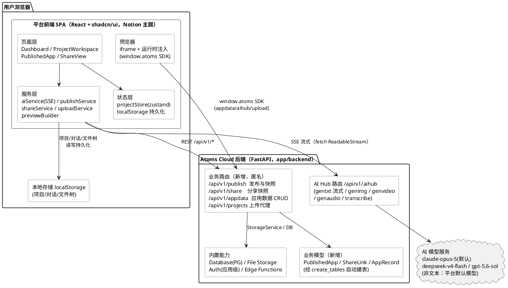
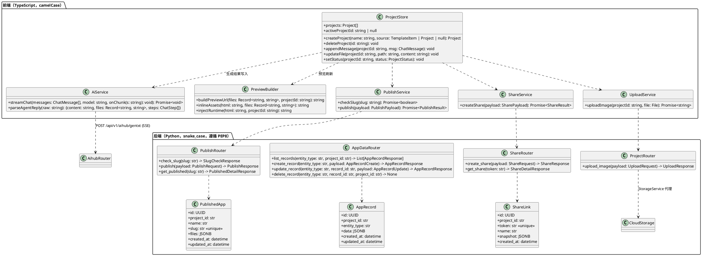
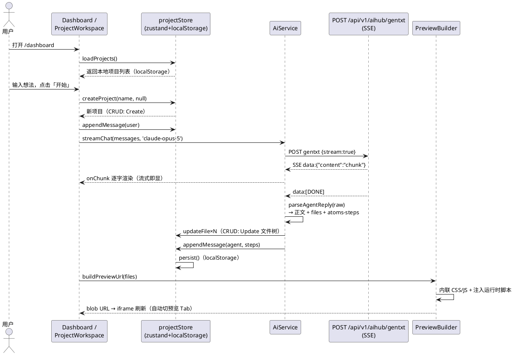
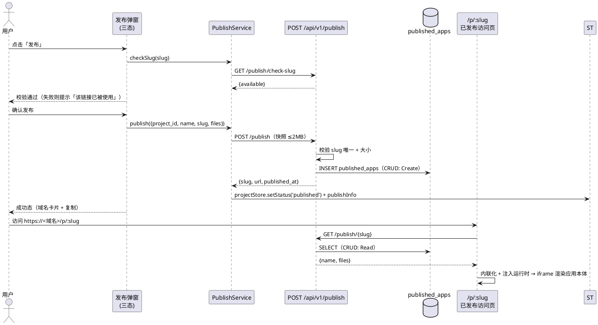
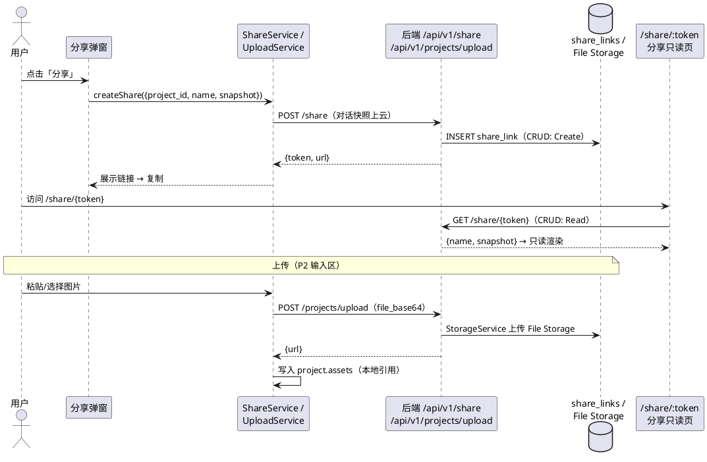
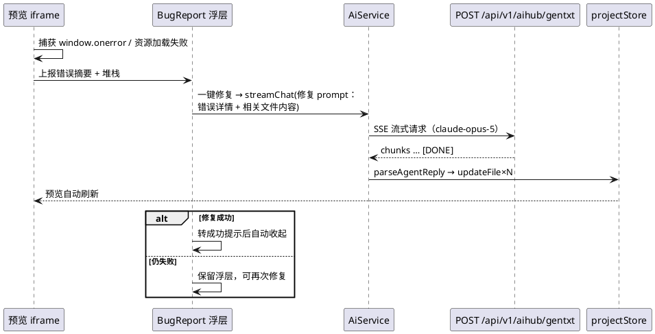
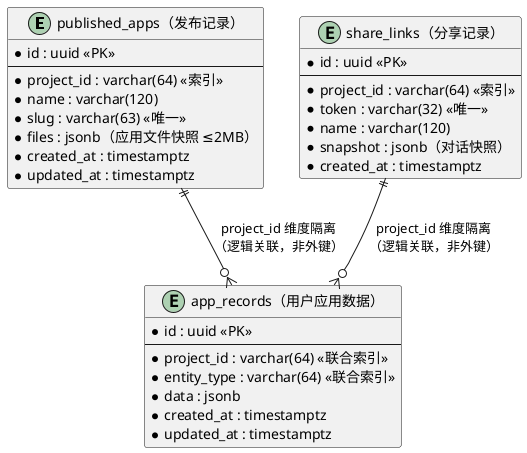
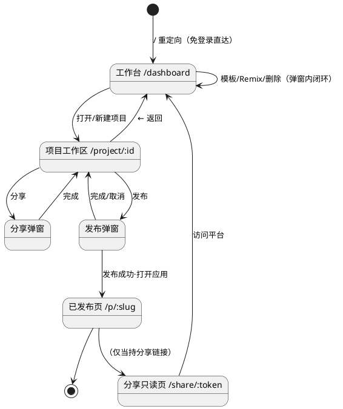

# 系统设计文档：复刻 Atoms 平台（atoms_platform_clone）

> 文档版本：v1.0 ｜ 阶段：技术方案设计阶段（待用户检查） ｜ 日期：2026-09-02
> 输入基线：PRD v3.0（docs/design/prd.md，已冻结）、UI 设计规范 v1.1（docs/design/ui-spec.md，已冻结）、/workspace/ARCHITECTURE.md、app/frontend（原型已完成）、app/backend（Atoms Cloud 已激活，受保护目录）
> 范围声明：仅覆盖 PRD「纳入初版 11 项（A1–A11）」；暂缓项（B1–B13）与不做项（C1–C10）不在本设计内；界面布局以 ui-spec v1.1（含左侧菜单栏）为准。

---

## 1. 实现路径（Implementation Approach）

### 1.1 关键难点与对策

| # | 难点 | 对策（初版取舍） |
|---|------|------------------|
| D1 | 对话驱动生成应用的**运行时**：平台无真实代码沙箱，如何让生成的应用"可预览、可发布、可访问" | 约定生成产物为**自包含单页 HTML 应用**（CSS/JS 内联或由预览器自动内联化），预览用 iframe blob URL 渲染，发布后 `/p/:slug` 从云端快照渲染。不引入构建管线（Vite/webpack 沙箱），端到端链路可真实跑通 |
| D2 | **无登录态**与后端现有鉴权依赖的冲突：模板自带 storage 等路由依赖 `get_current_user` | 平台业务走**新增匿名业务路由**（前缀 `/api/v1/`，按项目维度隔离），服务端内部调用 StorageService 完成上传；不新建用户表，不启用面向平台用户的登录 |
| D3 | **流式对话**与生成产物的结构化解析 | 直接复用后端 `/api/v1/aihub/gentxt` 的 SSE 流式能力；Prompt 约定 Agent 输出 `atoms-steps` 步骤块 + 完整文件代码块，前端解析后驱动「执行步骤折叠块 / Terminal 日志 / 文件树 / 预览」四处状态 |
| D4 | 用户构建的应用使用**平台后端能力**（M7：Auth/DB/存储/AI） | 生成应用时自动注入平台运行时脚本（`window.atoms` SDK）：数据走 `/api/v1/appdata` 通用记录 CRUD，AI 走 `/api/v1/aihub`，文件走上传端点；应用级登录复用 Atoms Cloud 内置 Auth（应用内注册/登录与平台自身免登录解耦） |
| D5 | **发布域名**形态 | 初版为同域路径 `https://<部署域名>/p/:slug`（统一子域需 DNS/网关配置，属部署环境事项，见第 13 章假设）；slug 全局唯一 + 自定义路径校验 |

### 1.2 技术选型（沿用现状，最小增量）

| 层 | 选型 | 说明 |
|----|------|------|
| 前端框架 | React 18 + TypeScript + Vite + shadcn/ui + Tailwind（app/frontend） | 已初始化，Notion 主题已接入 |
| 路由 / 服务端状态 | react-router-dom v6 + @tanstack/react-query | 已有 |
| 前端本地状态 | **新增 zustand**（轻量持久化 store） | 项目/对话/文件树为高频更新状态，Context 重渲染成本高；localStorage 持久化内置支持 |
| 后端 | FastAPI + SQLAlchemy async（Atoms Cloud 模板，app/backend） | 已激活；业务模型经 `BackendManager.create_tables` 自动建表 |
| AI 能力 | Atoms Cloud AI Hub：`/api/v1/aihub/gentxt`（SSE 流式）、`/genimg`、`/genvideo`、`/genaudio`、`/transcribe` | 文本模型池固定（见第 8 章），非文本用平台默认模型 |
| 文件存储 | Atoms Cloud File Storage（服务端代理调用 StorageService） | 素材/已发布静态资源 |
| 前后端通信 | @metagptx/web-sdk（`client`，app/frontend/src/lib/api.ts）+ 原生 fetch（SSE 流式） | 统一前缀 `/api/v1/` |

---

## 2. 用户与 UI 交互概览

交互细节以 ui-spec v1.1 为唯一依据，此处仅列主场景与系统侧配合点：

1. **免登录直达工作台**：`/` 重定向 `/dashboard`，左侧菜单栏 + 欢迎区 + 三种起点（模板/复制现有项目/空白）+ 本地项目列表；首次进入弹新手引导（localStorage 标记）。
2. **对话式开发**：输入需求 → 流式回复（打字光标）→ 执行步骤折叠块（`atoms-steps` 解析）→ 生成中自动切「预览」Tab → 预览 iframe 自动刷新。
3. **编辑/终端/预览三面板**：文件树选中加载代码区（可编辑保存，写回本地 store）；终端日志随生成事件追加、自动滚动；预览支持桌面/移动双视图。
4. **上传**：附件按钮或 Ctrl+V 粘贴图片 → 缩略图 chip → 上传云端获 URL（单文件限制）。
5. **发布**：三态弹窗（确认含 slug 校验 → 发布中 → 成功域名卡片）；成功后项目状态变「已发布」。
6. **分享**：生成公开链接（云端快照），复制即用；`/share/:token` 只读页。
7. **Bug Report**：预览 iframe 运行错误捕获 → 左下角浮层 →「一键修复」自动发起修复对话。

---

## 3. 总体架构

### 3.1 架构图（PlantUML）



### 3.2 模块职责边界

| 模块 | 职责 | 关键位置 |
|------|------|----------|
| 页面层 | 路由页面渲染（复用原型改造为接真数据） | `app/frontend/src/pages/` |
| 状态层 | 项目/对话/文件树单一数据源 + localStorage 持久化 | `src/stores/projectStore.ts`（新增） |
| 服务层 | 后端 API 调用、SSE 解析、预览 HTML 组装 | `src/services/*.ts`（新增） |
| 平台后端业务路由 | 发布/分享/应用数据/上传代理（匿名、按项目隔离） | `app/backend/routers/publish.py` 等（新增） |
| 平台后端业务模型 | 三张云端表（自动建表流程） | `app/backend/models/*.py`（新增文件，注册进 `models/__init__.py`，不改动模板核心） |
| Atoms Cloud 内置能力 | 数据库/文件存储/AI Hub/应用级 Auth | 模板既有，不改动 |

### 3.3 数据存储边界（无登录态核心约定）

| 数据 | 位置 | 说明 |
|------|------|------|
| 项目元信息、对话记录、文件树、文件内容 | **浏览器 localStorage**（经 projectStore） | 项目不与用户绑定；换设备/清缓存即失，属 PRD 3.3 已确认设计 |
| 上传素材（图片等） | **云端 File Storage**（返回 URL 存入项目 assets） | 本地仅存引用 |
| 发布记录 + 已发布应用文件快照 | **云端 PG `published_apps`** | slug 唯一；快照为 files JSON（≤2MB） |
| 分享快照（对话过程只读） | **云端 PG `share_links`** | token 唯一，公开访问 |
| 用户构建的应用业务数据 | **云端 PG `app_records`**（通用记录表，JSONB） | 按 project_id + entity_type 隔离；强结构化需求由 Agent 开发期新增模型文件走 create_tables |
| 用户表 | **不自建** | 平台免登录；应用级登录复用 Atoms Cloud 内置 Auth |

---

## 4. 数据结构与接口

### 4.1 类图（PlantUML，含精确类型标注）



### 4.2 API 契约（统一前缀 `/api/v1/`，除 aihub 为模板既有外均新增）

| 方法 | 路径 | 请求体 / 参数 | 响应 | 说明 |
|------|------|---------------|------|------|
| POST | /aihub/gentxt | `{model, messages:[{role,content}], stream:true}` | SSE：`data:{"content":"…"}` … `data:[DONE]` | 模板既有；流式对话唯一文本入口 |
| GET | /publish/check-slug?slug= | query: slug | `{available: bool}` | slug 校验（格式 `^[a-z0-9-]{3,40}$` + 占用检查） |
| POST | /publish | `{project_id, name, slug, files:{path:content}}` | `{slug, url, published_at}` | 写 `published_apps`；快照 ≤2MB |
| GET | /publish/{slug} | — | `{name, files, published_at}` | 已发布页拉取快照；404 → 失效态 |
| POST | /share | `{project_id, name, snapshot:{messages, files?}}` | `{token, url}` | 写 `share_links`，返回 `/share/{token}` |
| GET | /share/{token} | — | `{name, snapshot}` | 只读页拉取；404 → 失效态 |
| GET | /appdata/{entity_type}?project_id= | query: project_id | `[record…]` | 用户应用数据读 |
| POST | /appdata/{entity_type} | `{project_id, data:{…}}` | record | 用户应用数据增 |
| PUT | /appdata/{entity_type}/{record_id} | `{project_id, data:{…}}` | record | 用户应用数据改（project_id 不匹配 → 403） |
| DELETE | /appdata/{entity_type}/{record_id}?project_id= | query: project_id | 204 | 用户应用数据删 |
| POST | /projects/upload | `{project_id, filename, content_type, file_base64}` | `{url}` | 服务端代理 StorageService；≤5MB、图片类型白名单 |

> 匿名接口安全约定：内存级限速（每 IP 每分钟 30 次写操作）、payload 大小限制、slug/token 正则校验、appdata 按 project_id 精确匹配过滤；无任何个人数据收集（PRD 安全需求）。

### 4.3 前端核心类型（TypeScript）

```ts
type ProjectStatus = 'developing' | 'published';
interface Project {
  id: string;                 // nanoid 本地生成
  name: string;
  status: ProjectStatus;
  createdAt: number; updatedAt: number;
  messages: ChatMessage[];
  files: Record<string, string>;        // path -> content
  assets: Record<string, string>;       // 文件名 -> 云端 URL
  publishInfo?: { slug: string; url: string; publishedAt: number };
}
interface ChatMessage { id: string; role: 'user' | 'agent' | 'system';
  content: string; steps?: ChatStep[]; error?: boolean; attachments?: string[]; }
interface ChatStep { label: string; status: 'pending' | 'running' | 'done' | 'failed'; }
```

---

## 5. 程序调用流程（时序图）

### 5.1 项目初始化与对话式生成（流式，含本地 CRUD）



### 5.2 发布流程（平台内发布 → 域名访问）



### 5.3 分享与上传



### 5.4 Bug Report 一键修复



---

## 6. 数据库 ER 图（PlantUML）

> 仅三张云端业务表，均经 `BackendManager.create_tables` 自动建表（`models/` 新增文件注册即可）；**无用户表**；项目/对话数据在浏览器本地，不入库。



> 说明：project_id 为本地生成的项目标识（逻辑关联），三表之间不设数据库外键——项目主体数据在浏览器本地，云端表均以 project_id 字符串维度隔离与查询，与 PRD 3.3「发布/分享/应用数据按项目而非用户维度管理」一致。

---

## 7. UI 导航路径（FSM，≤4 层，每层有明确回路）



高频功能优先直达：工作台首屏即「开始构建」输入框；工作区常驻「发布/分享」按钮；每层均有返回工作台的明确路径。

---

## 8. AI 能力方案（模型标注）

| # | 调用点 | 端点 | 模型（用户指定池内） | 流式 |
|---|--------|------|----------------------|------|
| 1 | 对话生成/迭代应用（M2-2，A2） | POST /api/v1/aihub/gentxt | **claude-opus-5（默认）** | SSE stream=true |
| 2 | Bug 一键修复（M8-1，A10） | POST /api/v1/aihub/gentxt | claude-opus-5 | SSE stream=true |
| 3 | 用户应用内文本 AI（M7-4，A9） | window.atoms.ai.gentxt → /api/v1/aihub/gentxt | claude-opus-5（应用内可传池内三模型之一：claude-opus-5 / deepseek-v4-flash / gpt-5.6-sol） | 可选 |
| 4 | 用户应用内图像生成 | POST /api/v1/aihub/genimg | 平台默认（gemini-3-pro-image） | 否 |
| 5 | 用户应用内视频/音频/转写 | /genvideo / /genaudio / /transcribe | 平台默认模型 | 否（转写按端点默认） |

- **模型池硬约束**：后端 Prompt 组装层固定白名单 `{claude-opus-5, deepseek-v4-flash, gpt-5.6-sol}`，池外 model 参数一律拒绝（400）；平台自身 UI 不提供模型切换（B2 暂缓），初版固定默认模型。
- **Prompt 工程约定**（对话生成核心）：系统提示词内置多 Agent 角色心智（负责人→产品→架构→工程师协作过程），要求模型输出：①回复正文（Markdown）；②零或多个完整文件代码块（```lang path=xxx）；③末尾 `atoms-steps` fenced JSON（执行步骤，驱动折叠块与 Terminal 日志合成）。
- **Prompt 约定产物形态**：自包含单页 HTML（内联 `<style>/<script>`，或相对引用文件树内文件由 PreviewBuilder 内联化）；禁止依赖服务端运行时的框架。

---

## 9. 模板与 Remix 方案

| 能力 | 方案 |
|------|------|
| 官方内置模板（A11） | 前端静态模板包 `src/data/templates/`：每模板 = `{id, name, description, files, seedMessage?}`（自研自拟：SaaS 落地页/个人博客/电商商店/作品集/任务看板/活动报名页，与原型 mock 一致）。「从模板开始」= 深拷贝 files 为新本地项目 + 可选 seedMessage 作为首条对话上下文 |
| 复制现有项目（Remix 起步，A11） | Remix 弹窗列出本地全部项目 → 选择 → 深拷贝 `{messages, files, assets 引用}` → 新 project_id、新名称「{原名} 副本」、状态重置「开发中」→ 独立演化 |
| 边界 | 不做完整版本分叉/Versions 切换（B1 暂缓）；不做社区广场（C6） |

---

## 10. 非功能设计

| 类别 | 方案 |
|------|------|
| 错误处理与兜底 | 后端统一 `{detail}` 错误结构（模板既有 exception handler）；SSE 流内 `[ERROR]` 事件 → 对话区错误块 + Bug 浮层；slug/token 失效 → P8 兜底页；404 路由 → NotFound |
| 加载策略 | ≥300ms 显示反馈（Toast/spinner/骨架屏，按 ui-spec 第 7 章状态总表）；流式即显（首响应 ≤3s 目标依赖模型侧）；发布成功后域名可访问即生效（快照即时落库，无构建等待） |
| 仅中文落地 | 文案集中 `src/locales/zh.ts` 常量文件（不引 i18n 库，保留扩展点）；文案清单以 ui-spec 第 9 章为唯一来源 |
| Notion 主题保障 | 组件一律语义类（bg-background/text-foreground/border-border/shadow-sm/rounded-md 等）；**lint 门禁**：CI 增加正则扫描 `bg-(blue|gray|red|green|...)-|text-\[#|rounded-\[|shadow-\[`，命中即失败；新组件评审对照 ui-spec 第 2 章 |
| 性能 | 预览 iframe 懒加载（切到预览 Tab 才 build）；快照/分享 ≤2MB；localStorage 写入防抖（500ms） |
| 安全 | 匿名限速 + 大小限制 + 正则校验（见 4.2）；不收集个人数据；敏感项目数据留本地不上云（仅分享/发布时显式上云） |

---

## 11. UI 规范 → 模块/接口映射表（开发阶段实施依据）

| UI（ui-spec） | 前端模块 | 后端/接口 | PRD |
|---------------|----------|-----------|-----|
| P1 工作台（左侧菜单栏+三起点+项目列表） | pages/Dashboard + components/AppSidebar + projectStore | 本地 localStorage（无接口） | A1/A11 |
| P2 对话区（流式+步骤折叠块+上传） | pages/ProjectWorkspace + services/aiService + uploadService | /aihub/gentxt(SSE) + /projects/upload | A2/A3 |
| P2 面板-编辑器 | components/panels/EditorPanel + projectStore | 本地文件树 | A4 |
| P2 面板-终端 | components/panels/TerminalPanel | 生成事件流合成（本地） | A5 |
| P2 面板-预览 | components/panels/PreviewPanel + services/previewBuilder | blob URL（本地） | A6 |
| P3 发布弹窗 + P5 已发布页 | dialogs/PublishDialog + pages/PublishedApp | /publish CRUD | A7 |
| P4 分享弹窗 + P6 只读页 | dialogs/ShareDialog + pages/ShareView | /share CRUD | A8 |
| （无独立界面）应用后端能力 | 运行时注入脚本 runtime.ts → window.atoms | /appdata CRUD + /aihub/* + 应用级 Auth | A9 |
| Bug Report 浮层 | components/BugReport | 错误捕获（本地）+ /aihub/gentxt | A10 |
| P7 引导浮层 / P8 兜底页 | dialogs/Onboarding / pages/NotFound | localStorage 标记 | A11/A10 配套 |

---

## 12. 增量实施计划（开发阶段任务拆解建议，供 Mike/Alex 排期）

1. **数据层**：后端三模型文件 + 三业务路由 + 限速中间件；前端 zustand store 替换 mock 数据源。
2. **对话链路**：aiService（SSE fetch 解析）→ Prompt 工程（文件块/steps 约定）→ 流式 UI（打字光标/停止按钮）→ 步骤折叠块 + Terminal 合成。
3. **预览链路**：previewBuilder（内联化 + 运行时注入 + blob URL）+ 错误捕获。
4. **发布/分享**：两弹窗接真接口 + PublishedApp/ShareView 拉云端快照渲染。
5. **上传 + 应用 SDK**：上传代理路由接通 + runtime.ts（window.atoms）。
6. **收尾**：模板包正式化、新手引导接 localStorage、lint 门禁接入、全链路回归。

---

## 13. 假设与待澄清项（Unclear）

| # | 事项 | 当前假设（可先行开发） | 需用户确认点 |
|---|------|------------------------|--------------|
| 1 | 发布域名形态 | 同域路径 `https://<部署域名>/p/:slug`；统一子域（如 `*.atoms-clone.app`）需 DNS 泛解析与网关配置，属部署环境事项 | 若必须子域形态，请在发布部署阶段前告知，届时评估网关能力 |
| 2 | 生成应用形态 | 自包含单页 HTML（Agent 可产出 CDN 版 React 等，但无服务端运行时/构建沙箱） | 这是与 atoms.dev 真实沙箱能力的主要差距，属初版技术边界；如需更强运行时（构建型沙箱），需明确后单列方案 |
| 3 | 用户应用数据建模 | 初版以 `app_records` 通用 JSONB 记录表覆盖；强结构化表由 Agent 开发期新增模型文件走 create_tables | 无需用户操作，如用户应用需要专属表结构请提出 |
| 4 | 模板遗留页面处理 | 前端模板自带的 Auth 回调页与 blog 相关文件保留不删（避免破坏模板结构），不呈现任何入口 | 如需彻底清理请告知，会评估模板结构约束后处理 |
| 5 | 分享快照时效 | 初版分享快照永久有效（无过期机制） | 如需有效期/撤销能力，请在开发阶段前提出（建议随 B1 版本管理一并做） |