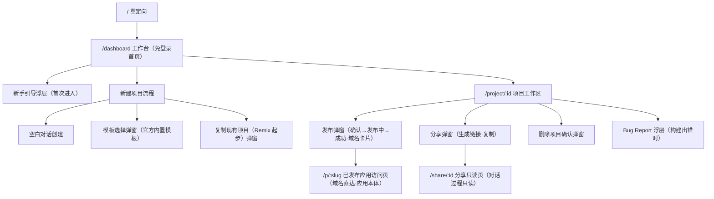

# UI 设计规范：复刻 Atoms 平台（atoms.dev）

> 文档版本：v1.1 ｜ 阶段：UI 设计阶段（待用户检查） ｜ 日期：2026-09-02
> v1.1 修订：2026-09-02 用户要求增加左侧菜单栏，覆盖原顶部导航设计（见 1.3 / 3.1 / 4.1）
> 输入基线：PRD v3.0（已冻结，docs/design/prd.md）｜ 设计系统：**Notion** 主题 ｜ 界面语言：仅中文
> 范围声明：本文档只做设计规范产出，不改代码；覆盖 PRD 第 10.1 节「纳入初版 11 项（A1–A11）」的界面呈现，第 10.2 节暂缓项不做设计（处理策略见第 11 章）。

---

## 1. 文档说明

### 1.1 目的与范围

本文档定义「复刻 atoms.dev 平台」Web 应用的信息架构、页面布局、关键组件、交互规范与样式规范，作为技术方案设计（Bob）与开发实现（Alex）的 UI 唯一依据。

### 1.2 设计原则（Notion 风格）

| # | 原则 | 落地要求 |
|---|------|----------|
| P1 | **内容优先、克制装饰** | 界面以灰阶为主，无彩色品牌色；仅 destructive（危险操作）使用唯一彩色语义；大面积留白，行高宽松 |
| P2 | **柔和低对比层次** | 层次靠灰度（background/card/sidebar/muted）与轻阴影（shadow-xs/sm）区分，不依赖粗边框与强投影 |
| P3 | **小圆角、细边框** | 统一基于 --radius: 0.5rem 的圆角体系；边框统一 1px、色值 border-border（88% 灰） |
| P4 | **一致性** | 全部组件使用 shadcn/ui 语义类（bg-background、text-foreground、border-border 等），禁止任何硬编码视觉值 |
| P5 | **零门槛** | 无登录态直达；主链路每一步都有明确下一步指引与中文反馈 |

### 1.3 无登录态设计总则

- 站点首页即工作台（/ 重定向至 /dashboard），无任何登录/注册入口与账户 UI。
- 全局导航采用左侧菜单栏（2026-09-02 用户要求增加，覆盖原顶部导航设计）：含 Logo、主导航（工作台/模板/使用指引）与底部「帮助」入口，不呈现头像/账户菜单。
- 项目数据存浏览器本地，项目卡片上的操作（打开/删除）均本地生效。
- 发布/分享链接均为公开访问，访问页无任何权限门槛提示。

---

## 2. 设计系统规范（Notion 主题落地）

> 以下变量已在 app/frontend/src/index.css 与 tailwind.config.ts 接入（任务1完成），本章规定其使用场景，开发时一律通过语义类引用。

### 2.1 色彩系统（亮色模式为默认，暗色变量已配置暂不开放切换入口）

| 语义变量 | 亮色值 (HSL) | 用途 | 对应 Tailwind 语义类 |
|----------|--------------|------|----------------------|
| --background | 0 0% 97% | 页面底色（近白灰） | bg-background |
| --foreground | 0 0% 10% | 正文主文字（近黑） | text-foreground |
| --card | 0 0% 100% | 卡片/浮层底（纯白） | bg-card |
| --card-foreground | 0 0% 10% | 卡片内文字 | text-card-foreground |
| --primary | 0 0% 20% | 主操作按钮/强调底（深灰） | bg-primary |
| --primary-foreground | 0 0% 98% | 主按钮文字（白） | text-primary-foreground |
| --secondary | 0 0% 92% | 次级按钮/次要底 | bg-secondary |
| --secondary-foreground | 0 0% 20% | 次级按钮文字 | text-secondary-foreground |
| --muted | 0 0% 92% | 弱底色（占位、禁用底、代码底） | bg-muted |
| --muted-foreground | 0 0% 45% | 弱文字（辅助说明、时间戳、占位符） | text-muted-foreground |
| --accent | 0 0% 94% | 悬停高亮底（列表项 hover、菜单 hover） | hover:bg-accent |
| --accent-foreground | 0 0% 20% | 高亮底上的文字 | text-accent-foreground |
| --destructive | 0 70% 50% | 唯一彩色语义：删除/错误/危险操作 | bg-destructive / text-destructive |
| --destructive-foreground | 0 0% 98% | 危险按钮文字 | text-destructive-foreground |
| --border | 0 0% 88% | 全部边框/分隔线 | border-border |
| --input | 0 0% 88% | 输入框边框 | border-input |
| --ring | 0 0% 40% | 聚焦环（键盘导航/输入聚焦） | focus-visible:ring-ring |
| --sidebar | 0 0% 96% | 右侧工具面板底色 | bg-sidebar |
| --sidebar-foreground | 0 0% 20% | 面板内文字 | text-sidebar-foreground |
| --sidebar-border | 0 0% 88% | 面板分隔边框 | border-sidebar-border |
| --sidebar-accent | 0 0% 92% | 面板内高亮（文件树 hover/选中） | hover:bg-sidebar-accent / bg-sidebar-accent |

**禁令**：不得出现 bg-blue-500、text-[#333]、border-gray-200 等硬编码色值；不得新增主题外颜色。

### 2.2 字体系统

| 变量 | 字体栈 | 用途 |
|------|--------|------|
| --font-sans（默认） | -apple-system, BlinkMacSystemFont, 'Segoe UI', Helvetica, Arial, sans-serif | 全站界面与正文（类名 font-sans，body 默认继承） |
| --font-mono | SFMono-Regular, Menlo, Monaco, Consolas, monospace | 代码编辑器、代码块、Terminal 日志、文件名、域名（类名 font-mono） |
| --font-serif | Georgia, 'Times New Roman', serif | 本期不使用（预留） |

字号阶梯（基于 Tailwind 默认阶）：正文 text-sm（14px，界面默认）、对话消息 text-sm、标题 text-base/text-lg、页面主标题 text-xl、辅助 text-xs。行高：正文 leading-relaxed；对话消息 leading-6。

### 2.3 圆角系统（基准 --radius: 0.5rem）

| 场景 | 类名 | 说明 |
|------|------|------|
| 按钮/输入框/下拉/小浮层 | rounded-md | 由 --radius 派生 |
| 卡片/弹窗/大容器 | rounded-lg | 由 --radius 派生 |
| 消息气泡 | rounded-lg（用户气泡右下角 rounded-md 收角） | 对话区专用约定 |
| 头像/徽标/标签 | rounded-full | 圆形 |

### 2.4 阴影系统（Notion 柔和灰阶阴影）

| 变量 | 用途 |
|------|------|
| --shadow-xs / shadow-xs | 输入框、小按钮静默态（极轻） |
| --shadow-sm / shadow-sm | 卡片、Tab 容器默认投影 |
| --shadow-md / shadow-md | 下拉菜单、浮层（Bug Report、Toast） |
| --shadow-lg / shadow-lg | 弹窗（Dialog） |
| --shadow-xl / 2xl | 本期不使用（预留） |

### 2.5 间距与栅格

- 基准 --spacing: 0.25rem，按 4px 网格取值（p-2/p-4/p-6）。
- 页面内容最大宽度：工作台内容区 max-w-6xl 居中；项目工作区全宽双栏。
- 双栏比例：对话区 : 工具面板 ≈ 1 : 1（可拖拽分隔条，最小 320px、默认各 50%）。

### 2.6 图标

- 使用 lucide-react 图标库（shadcn/ui 默认搭配），线条风格与 Notion 灰阶一致，尺寸统一 16px（行内）/20px（按钮），颜色继承 text-foreground 或 text-muted-foreground。

---

## 3. 信息架构与页面清单

### 3.1 站点地图

> 2026-09-02 用户要求增加左侧菜单栏，覆盖原顶部导航设计：工作台（/dashboard）左侧固定菜单栏承载全局导航（Logo + 工作台/模板/使用指引 + 帮助），路由结构不变。



### 3.2 路由设计表

| 路由 | 页面 | 呈现形态 | 说明 |
|------|------|----------|------|
| /dashboard（/ 重定向至此） | P1 工作台 | 完整界面 | 免登录首页，项目列表 + 三种创建起点 |
| /project/:id | P2 项目工作区 | 完整界面 | 左对话区 + 右工具面板（Editor/Terminal/App Viewer） |
| /p/:slug | P5 已发布应用访问页 | **仅应用本体** | 发布域名直达；不渲染平台框架/顶栏（对标 atoms 发布结果为纯应用） |
| /share/:id | P6 分享只读页 | 只读界面 | 展示项目对话构建过程 + 「查看已发布应用」入口（如已发布） |

弹窗类（无独立路由）：发布弹窗、分享弹窗、模板选择弹窗、Remix 复制弹窗、删除确认、新手引导。

### 3.3 页面清单与优先级

| 编号 | 页面/流程 | 优先级 | 覆盖 PRD 纳入项 |
|------|-----------|--------|-----------------|
| P1 | 工作台 Dashboard | P0 | A1、A11 |
| P2 | 项目工作区（对话区 + 三面板） | P0 | A2、A3、A4、A5、A6、A10 |
| P3 | 发布弹窗（含域名成功卡片） | P0 | A7 |
| P4 | 分享弹窗 | P0 | A8 |
| P5 | 已发布应用访问页 | P0 | A7、A9（后端能力复刻的界面载体） |
| P6 | 分享只读页 | P0 | A8 |
| P7 | 新手引导浮层 | P1 | A11 |
| P8 | 错误/兜底页（404、生成失败页） | P1 | A10 配套 |

---

## 4. 页面详细设计

### 4.1 P1 工作台 Dashboard（免登录首页）

**布局结构**：

```
┌──────────────┬────────────────────────────────────────────────┐
│ 左侧菜单栏    │ 主内容区（bg-background）                       │
│ (w-56)       │                                                │
│  Logo 区     │  欢迎区（居中，max-w-3xl）：                     │
│ 「Atoms 克隆」│  H1「把想法变成产品」(text-2xl, font-semibold)   │
│ ──────────── │  副文案「描述你的想法，AI 团队几分钟内完成构建」   │
│ ▣ 工作台 选中 │  ┌──────────────────────────────────────────┐  │
│ ○ 模板       │  │ 「开始构建」输入框 + 按钮「开始」            │  │ bg-card, border-input,
│ ○ 使用指引   │  └──────────────────────────────────────────┘  │ shadow-sm, rounded-lg
│ (底部) 帮助  │                                                │
│ bg-sidebar   │  快捷起点区（三卡片横排，hover:bg-accent 过渡）： │
│ border-r     │  [内置模板] [复制现有项目] [空白新建]             │ bg-card, border-border,
│ border-      │                                                │ shadow-sm, rounded-lg
│ sidebar-     │  我的项目（区块标题 + 搜索输入框）                │
│ border       │  项目卡片网格（grid 3列）：名称/状态徽标/时间      │
│ 选中/悬停：   │  hover 出现「打开」「删除」操作                   │
│ bg-sidebar-  │  [空状态：暂无项目，引导从上方起点开始]           │
│ accent       │                                                │
└──────────────┴────────────────────────────────────────────────┘
```

**关键组件说明**：

| 组件 | 规范 |
|------|------|
| 开始构建输入框 | 大输入域（textarea 自适应 1–4 行），右下角「开始」主按钮（bg-primary）；输入非空时按钮可用，回车提交 |
| 快捷起点卡片 | 三张等宽卡片，图标 + 标题 + 一句说明；点击分别打开模板弹窗 / Remix 弹窗 / 直接创建空白项目并跳转工作区 |
| 项目卡片 | bg-card + border-border + shadow-sm + rounded-lg；状态徽标：「开发中」bg-muted text-muted-foreground，「已发布」bg-secondary text-secondary-foreground；hover 显示操作按钮（打开=secondary、删除=ghost 红字 text-destructive） |
| 搜索框 | border-input，左侧搜索图标，placeholder「搜索项目」 |
| 左侧菜单栏 | （2026-09-02 新增，覆盖原顶部导航）固定 w-56，bg-sidebar + border-r border-sidebar-border；Logo 区 h-12 带 border-b；导航项 text-sidebar-foreground，选中/悬停 bg-sidebar-accent；底部「帮助」text-muted-foreground |

### 4.2 P2 项目工作区（核心界面）

**布局结构**：

```
┌────────────────────────────────────────────────────────────────────┐
│ 顶部栏 (h-12, bg-background, border-b border-border)：              │
│ 左：返回工作台箭头 + 项目名（可编辑，text-sm font-medium）            │
│ 右：按钮「发布」(bg-primary, size-sm) + 按钮「分享」(bg-secondary)   │
├──────────────────────────────────┬─────────────────────────────────┤
│ 对话区 (bg-background)            │ 工具面板 (bg-sidebar,           │
│                                  │ border-l border-sidebar-border) │
│ ┌──────────────────────────────┐ │ ┌─────────────────────────────┐ │
│ │ 消息滚动区（flex-col，底对齐） │ │ │ 面板 Tab：编辑器 | 终端 |    │ │
│ │ ┌ Agent 消息（左对齐）        │ │ │ 预览（bg-sidebar, 选中态    │ │
│ │ │ 无气泡底色，Agent 头像圆标  │ │ │ bg-sidebar-accent）         │ │
│ │ └ 用户消息（右对齐气泡：      │ │ ├─────────────────────────────┤ │
│ │   bg-primary text-primary-   │ │ │ 面板内容区：                 │ │
│ │   foreground, rounded-lg）   │ │ │  编辑器：文件树 + 代码区     │ │
│ │ ┌ 执行步骤折叠块（Agent 回复  │ │ │  （文件树 bg-sidebar,        │ │
│ │   内）：「已创建 3 个文件 ▸」 │ │ │   选中项 bg-sidebar-accent) │ │
│ │   展开=步骤列表（text-xs,    │ │ │  终端：日志流（font-mono,    │ │
│ │   text-muted-foreground）    │ │ │   text-sidebar-foreground,  │ │
│ └──────────────────────────────┘ │ │   bg-muted 底)              │ │
│ ┌──────────────────────────────┐ │ │  预览：App Viewer 容器 +     │ │
│ │ 输入区（sticky 底部）：        │ │ │  顶部视图切换（桌面/移动）   │ │
│ │ 附件按钮(回形针图标)+图片粘贴 │ │ └─────────────────────────────┘ │
│ │ 多行输入框 + 发送按钮(圆形    │ │                                 │
│ │ bg-primary, 空输入禁用)       │ │                                 │
│ │ 提示行：「Enter 发送，        │ │                                 │
│ │ Shift+Enter 换行」text-xs     │ │                                 │
│ └──────────────────────────────┘ │                                 │
├──────────────────────────────────┴─────────────────────────────────┤
│ 左下角浮层（构建出错时）：Bug Report 卡片（见 5.10）                 │
└────────────────────────────────────────────────────────────────────┘
```

**关键组件说明**：

| 组件 | 规范 |
|------|------|
| 消息流 | 用户消息：右对齐气泡 bg-primary text-primary-foreground（深底白字，Notion 式克制）；Agent 消息：左对齐、无底色、前置圆形 Agent 头像标识（bg-muted 内 lucide 图标），Markdown 渲染（标题/列表/表格/代码块 bg-muted rounded-md p-3 font-mono text-sm） |
| 执行步骤折叠块 | Agent 消息内嵌「▸ 已创建 3 个文件」摘要行（text-xs text-muted-foreground，chevron 旋转交互）；展开显示步骤明细与状态点（进行中=spinner、完成=check、失败=text-destructive）；同一时刻 Terminal 面板同步全量日志 |
| 流式输出 | Agent 消息尾部打字光标（▍闪烁，bg-foreground）；流式期间发送按钮变为「停止」方块图标按钮（bg-secondary） |
| 输入区 | 附件按钮（回形针）触发图片选择；支持 Ctrl+V 粘贴图片生成缩略图 chip（可移除）；单文件限制（PRD A3）；文件类型错误时输入区下方 text-destructive 提示 |
| 面板 Tab | 三等分 Tab（编辑器/终端/预览），选中态 bg-sidebar-accent + text-sidebar-foreground font-medium；生成进行中「预览」Tab 显示小红点脉动提示（bg-destructive 圆点，非彩色装饰、仅状态语义） |
| 顶部栏按钮 | 「发布」「分享」均 size-sm；发布在生成进行中禁用（tooltip「生成完成后可发布」） |
| 中缝分隔条 | 可拖拽（1px hover 加宽至 4px 且 bg-accent），调整双栏比例，比例持久化到 localStorage |

### 4.3 P3 发布弹窗（发布流程）

三态单弹窗（Dialog，bg-card rounded-lg shadow-lg max-w-md）：

| 状态 | 内容 |
|------|------|
| ① 确认态 | 标题「发布应用」；说明文案「发布后将生成可直接访问的域名链接」；自定义路径输入框（前缀固定展示平台域名，输入框默认填自动生成 slug，font-mono）；主按钮「确认发布」+ 次按钮「取消」 |
| ② 发布中态 | spinner + 「正在发布…」；按钮全部禁用；预计时长提示「通常 1 分钟内完成」 |
| ③ 成功态 | check 图标 + 「发布成功」；域名卡片（bg-muted rounded-md p-3 font-mono text-sm + 复制按钮，复制后按钮短暂变「已复制」）；按钮「打开应用」（secondary，新标签打开 /p/:slug）+「完成」（primary，关闭弹窗；项目状态更新为「已发布」） |

发布失败态：卡片内 text-destructive 错误说明 +「重试」按钮。

### 4.4 P4 分享弹窗

Dialog（max-w-md）：标题「分享项目」；说明「任何获得链接的人都可查看此项目的构建过程」；链接展示条（bg-muted font-mono + 复制按钮）；无权限分级选项（无登录态简化，见 PRD 3.3）；次按钮「完成」。项目未发布时弹窗底部附提示行（text-xs text-muted-foreground）：「提示：分享的是构建过程；如需交付可访问的应用，请先发布。」

### 4.5 P5 已发布应用访问页（/p/:slug）

- **仅渲染用户应用本体**：全屏应用视图，无平台顶部栏、无平台标识（对标 atoms 发布结果的纯应用形态）。
- 应用的后端能力（登录/数据/AI）由平台 M7 能力支撑，本页无额外 UI。
- 加载态：居中 spinner；失效态（slug 不存在）：居中卡片「链接不存在或已被删除」+「访问平台」文字链接。

### 4.6 P7 新手引导浮层（首次进入工作台）

- 形态：居中 Dialog 卡片（max-w-lg），三步轮播（圆点指示器）：①「对话生成应用」②「编辑与实时预览」③「一键发布获得域名」，每步 = 简笔示意区（bg-muted 占位插画区）+ 标题 + 一句话说明。
- 按钮：「跳过」（ghost）+「下一步/开始使用」（primary）。完成后 localStorage 标记不再弹出。

### 4.7 P8 错误与兜底页

| 页面 | 触发 | 设计 |
|------|------|------|
| 404 页 | 路由未命中 | 居中：「页面不存在」+「返回工作台」主按钮 |
| 生成失败页内联态 | 对话生成失败 | 对话区内嵌错误消息块（border border-destructive/40 rounded-md）：错误摘要 +「重试」按钮 |

---

## 5. 关键组件规范（shadcn/ui 对齐）

### 5.1 按钮体系

| 变体 | 类组合 | 使用场景 |
|------|--------|----------|
| Primary | bg-primary text-primary-foreground hover:bg-primary/90 rounded-md | 开始构建、发送、确认发布、开始使用 |
| Secondary | bg-secondary text-secondary-foreground hover:bg-secondary/80 | 分享、打开应用、打开项目 |
| Ghost | hover:bg-accent text-accent-foreground | 卡片内删除、跳过、关闭 |
| Destructive | bg-destructive text-destructive-foreground hover:bg-destructive/90 | 删除确认弹窗内「确认删除」 |
| 禁用态 | opacity-50 pointer-events-none | 统一 50% 透明，不换灰阶值 |

### 5.2 弹窗与确认对话框

- Dialog 统一：bg-card border-border rounded-lg shadow-lg，遮罩 bg-foreground/40（黑色 40% 透明，符合 Notion 柔和遮罩）。
- 删除确认专用：标题「删除项目」、正文「删除后无法恢复，确定删除「{项目名}」吗？」、确认按钮 Destructive。

### 5.3 Toast 反馈

位置：底部居中；样式 bg-card border-border shadow-md rounded-md；成功带 check 图标（text-foreground，Notion 式不引入绿色）、失败带 text-destructive 图标；3 秒自动消失。

### 5.4 空状态

结构：muted 灰插画占位（bg-muted rounded-lg 内置 lucide 图标）+ 标题 + 一句引导 + 行动按钮（如「新建项目」）。全部空状态文案见第 9 章清单。

---

## 6. 交互规范

### 6.1 全局原则

1. 任何等待超过 300ms 的操作必须有加载反馈；超过 10 秒的操作展示阶段文案（如「正在生成…」→「正在构建页面…」）。
2. 破坏性操作（删除）必须二次确认；发布为不可逆可见操作，需弹窗确认。
3. 键盘可达：所有交互元素 focus-visible 显示 ring-ring 聚焦环。

### 6.2 流式对话交互（状态机）

```
[空闲] --用户发送--> [发送中·本地即时上屏] --请求成功--> [生成中]
  ↑                    |失败：Toast 错误，输入内容还原可编辑      |
  |                                                             |
  [完成] <--生成结束（消息定格·面板刷新·发布按钮解禁）<----流式输出中
                              |用户点击停止                    |
                              └--> [已停止]：保留已输出内容，
                                   追加系统提示「已停止生成」（text-muted-foreground）
```

规则：
- 生成中禁止再次发送（输入框保留可编辑，发送按钮变「停止」）。
- 生成中自动切换右面板至「预览」Tab（用户手动切走后本会话不再自动切换）。
- 生成出错时触发 Bug Report 浮层（6.4）。

### 6.3 面板切换交互

- 点击 Tab 即切，内容切换无动画（Notion 式干脆）；Tab 选中态见 4.2。
- 「编辑器」内文件树选中文件即加载右侧代码区；代码可编辑，「保存」按钮（修改未保存时按钮高亮 + 关闭前确认）。
- 「终端」日志自动滚动到底部；用户向上滚动时暂停自动滚动并显示「回到底部」悬浮 chip。

### 6.4 Bug Report 浮层（Bug Fix 入口）

```
触发：构建/生成出错
浮层（fixed 左下角, bg-card border-border shadow-md rounded-md max-w-sm）：
  标题行：「构建出现问题」+ 关闭(×)
  错误摘要（text-sm, 单行截断）
  操作行：链接按钮「查看详情」（展开完整错误，font-mono text-xs,
          bg-muted 块）+ 主按钮「一键修复」
「一键修复」点击 → 自动以修复指令发起对话（输入框短暂锁定并显示
  「正在修复…」）→ 结果：成功=浮层转成功提示后自动收起；失败=浮层
  保留并可再次修复
```

### 6.5 发布确认流程

见 4.3 三态。补充规则：路径输入实时校验（格式与占用检查，非法时 border-destructive + text-destructive 提示「该链接已被使用」）；发布成功后项目卡片状态即时更新为「已发布」。

### 6.6 删除确认与上传交互

- 删除项目：点删除 → 5.2 确认弹窗 → 确认后本地移除 + Toast「已删除」。
- 图片上传：点回形针或粘贴 → 缩略图 chip 显示于输入框上方（80×80，rounded-md，右上角 × 移除）；超限（单文件）时 text-destructive 提示。

### 6.7 键盘快捷键

| 快捷键 | 行为 |
|--------|------|
| Enter（输入框内） | 发送消息 |
| Shift + Enter | 输入框换行 |
| Esc | 关闭弹窗/停止流式（生成中时优先停止流式） |

---

## 7. 状态设计总表

| 场景 | 加载态 | 空状态 | 错误态 | 成功态 |
|------|--------|--------|--------|--------|
| 项目列表 | 骨架屏卡片 ×3（bg-muted 脉动） | 「还没有项目，从上方选择一种方式开始」 | 内联错误 + 重试 | — |
| 对话消息 | Agent 消息占位（打字指示器） | 欢迎引导卡片「描述你的第一个想法」 | 消息内错误块 + 重试 | — |
| 预览面板 | 构建中占位（spinner + 阶段文案） | 「发送第一条消息后开始预览」 | 预览失败占位 + 重试 | — |
| 发布 | 弹窗发布中态 | — | 弹窗失败态 + 重试 | 弹窗成功态·域名卡片 |
| 已发布页 | 居中 spinner | — | 「链接不存在或已被删除」 | 应用本体 |

---

## 8. 响应式设计

| 断点 | 布局 |
|------|------|
| ≥1280px | 工作区双栏各 50%；工作台三列卡片 |
| 1024–1279px | 双栏保留，面板最小 320px；工作台两列卡片 |
| <1024px（移动浏览适配） | 工作台单列；项目工作区改为主视图 + 底部 Tab 切换（对话/编辑器/终端/预览），同一时刻单面板 |
| 已发布页 /p/:slug | 应用自身响应式（生成时由 Agent 保障），平台不加框架 |

---

## 9. 文案规范与文案清单（仅中文）

**规范**：仅中文（用户确认）；语气简洁友好；按钮用动词短语（≤4 字优先）；错误文案必须包含「发生了什么 + 怎么办」；不使用英文混排（模型名、域名等技术名词除外）。

| 位置 | 文案 |
|------|------|
| 工作台主标题 | 把想法变成产品 |
| 工作台副文案 | 描述你的想法，AI 团队几分钟内完成构建 |
| 输入框占位 | 描述你想做的应用… |
| 起点卡片 | 内置模板 / 复制现有项目 / 空白新建 |
| 模板弹窗标题 | 从模板开始 |
| Remix 弹窗标题 | 复制现有项目 |
| 发布弹窗 | 发布应用 / 确认发布 / 正在发布… / 发布成功 |
| 分享弹窗 | 分享项目 / 任何获得链接的人都可查看此项目的构建过程 |
| Bug 浮层 | 构建出现问题 / 查看详情 / 一键修复 / 正在修复… |
| 删除确认 | 删除项目 / 删除后无法恢复，确定删除吗？ |
| 引导 | 三步把想法变成产品：对话生成 → 编辑预览 → 发布获得域名 |
| 常见错误 | 生成失败，请重试 / 该链接已被使用，换一个试试 / 网络异常，请检查连接后重试 |

---

## 10. 需求覆盖映射表（PRD 纳入 11 项 → 界面呈现）

| PRD 项 | 能力 | 界面落点 |
|--------|------|----------|
| A1 | 工作台 Dashboard | P1 全页（免登录直达、项目列表/创建/删除） |
| A2 | 对话式开发 | P2 对话区（消息流/流式/执行步骤折叠块；默认模型无切换 UI） |
| A3 | 文件/图片上传 | P2 输入区（附件按钮、粘贴、缩略图 chip） |
| A4 | Editor 代码编辑器 | P2 面板-编辑器（文件树 + 代码编辑 + 高亮 + 保存） |
| A5 | Terminal 执行日志 | P2 面板-终端（日志流、自动滚动、回到底部） |
| A6 | App Viewer 双视图预览 | P2 面板-预览（桌面/移动切换容器） |
| A7 | 一键发布与域名访问 | P2 顶部「发布」+ P3 弹窗三态 + P5 已发布访问页 |
| A8 | 分享链接生成+复制 | P2 顶部「分享」+ P4 弹窗 + P6 分享只读页 |
| A9 | 平台后端能力复刻 | 无独立界面；载体为 P5（应用使用内置 Auth/数据/存储/AI/托管） |
| A10 | Bug Report + Fix Bug | P2 左下角浮层 + 6.4 交互 |
| A11 | 模板与起步 + 新手引导 | P1 三起点卡片 + 模板/Remix 弹窗 + P7 引导浮层 |

**覆盖结论**：A1–A11 全部有对应界面呈现，无遗漏。

---

## 11. 暂缓项界面处理说明（本期不设计）

| 暂缓项（PRD B1–B13 摘要） | 界面处理 |
|---------------------------|----------|
| Remix 完整分叉 + Versions 版本切换（B1） | 顶部栏**不放置** Versions 入口（PRD 8.3 草案中的 Versions 属 B1 范围，按「暂缓项不设计」约束移除）；轻量「复制现有项目起步」已由 A11 覆盖 |
| 模型切换 UI（B2） | 输入框不呈现模型选择器（默认模型，文案见第 9 章） |
| 导出代码/GitHub（B3→已改 C2 不做） | 界面无任何导出入口 |
| 积分/配额（B4） | 工作台无余额/用量卡片 |
| 提示词润色、Race Mode、Deep Research、模式切换（B5–B9） | 输入框仅保留发送与附件，无模式/润色/竞赛入口 |
| 可视化编辑器（B6） | 面板 Tab 仅三个（编辑器/终端/预览） |
| 设置页、状态标识（B10） | 无设置入口；「已发布」徽标保留（属 A1 项目卡片，非 B10 的状态管理功能） |
| SEO/Ads 智能体、社交分享、预览元素替换、Supabase 连接器（B11–B13） | 分享弹窗无社交平台按钮；预览无元素选择模式；设置内无连接器入口 |